# Implementation Report — D’titans Food Landing Page

**Build date:** 10 November 2026
**Status:** Complete implementation. **Not launch-ready** until the contact placeholders, official platform assets, and real photography are supplied. No link or claim in the page is invented as live.

## What was delivered

A static, mobile-first, single-page Astro site for D’titans Food, built around a warm “kitchen ledger” editorial direction rather than a generic catering card grid.

- Astro 7 + Tailwind CSS 4 + TypeScript, fully static.
- Cormorant Garamond and DM Sans self-hosted; no third-party font request at runtime.
- All ten requested sections in order: Header & Hero, Favorites, Catering, Our Story, Why Choose Us, Gallery, Recipe E-book, How to Order, Available On, Footer.
- Six favorite products in a typographic menu index with WhatsApp prefills.
- Three catering categories with category-specific WhatsApp prefills and no invented package details.
- Accessible mobile navigation using a native `<dialog>`, focus containment, Escape handling, and a compact mobile header WhatsApp CTA.
- Responsive editorial compositions at 360, 390, 768, 1024, and 1440 px.
- Configurable e-book CTA and platform-link guard: unset URLs never navigate, never jump to the top, and are announced as unavailable.
- SEO metadata in Bahasa Indonesia, canonical URL, Open Graph/Twitter cards, robots file, sitemap, favicon, and Apple touch icon.
- Optimized responsive images, lazy-loading below the fold, eager/high-priority hero image, self-hosted fonts, and explicit dimensions/aspect ratios.
- Reduced-motion support; one orchestrated hero reveal instead of scattered animation.
- Editable site configuration, copy, product data, service data, and gallery data in `src/data/`.

### Brand assets

- The supplied `logo.png` is used as-is in the header and footer, with `mix-blend-mode: multiply` in the header to sit cleanly on Warm Ivory. The favicon is a crop of this supplied logo.
- No official GoFood, ShopeeFood, or GrabFood assets were supplied. See **Known limitations**.

## Screenshots

Captured from the production build with reduced motion enabled. The complete desktop and mobile pages are linked below; the section shots were captured with fixed page chrome hidden for legibility.

### Desktop — 1440 px

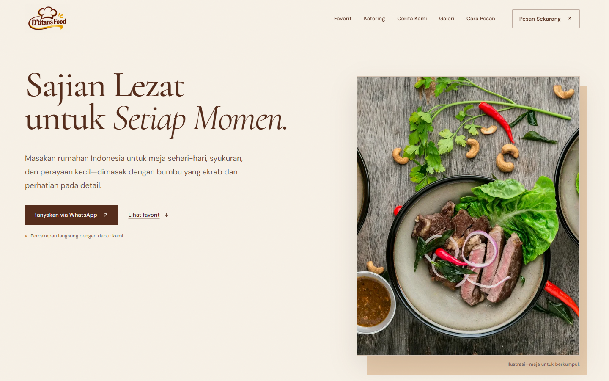

[Full desktop page](docs/screenshots/desktop-full.png) · [1024 px hero](docs/screenshots/desktop-1024-hero.png)

### Mobile — 390 px

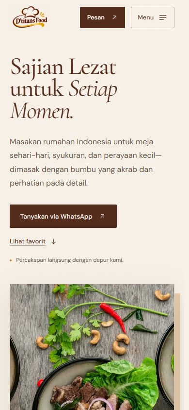

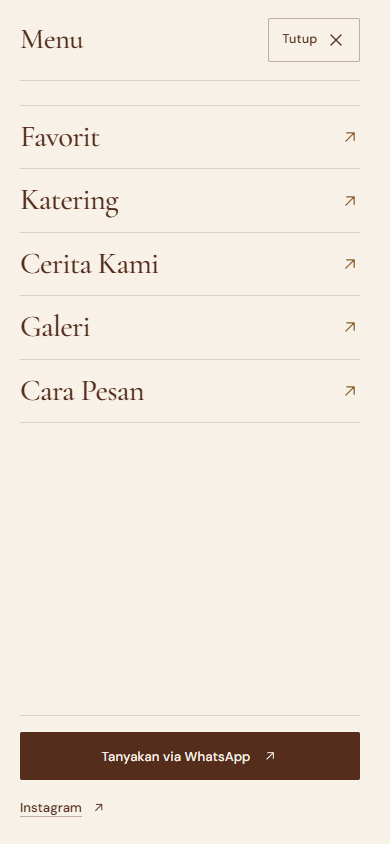

[Full mobile page](docs/screenshots/mobile-full.png) · [360 px hero](docs/screenshots/mobile-360-hero.png) · [Tablet 768 px](docs/screenshots/tablet-768-hero.png)

### Sections

| Favorites | Catering |
| --- | --- |
| 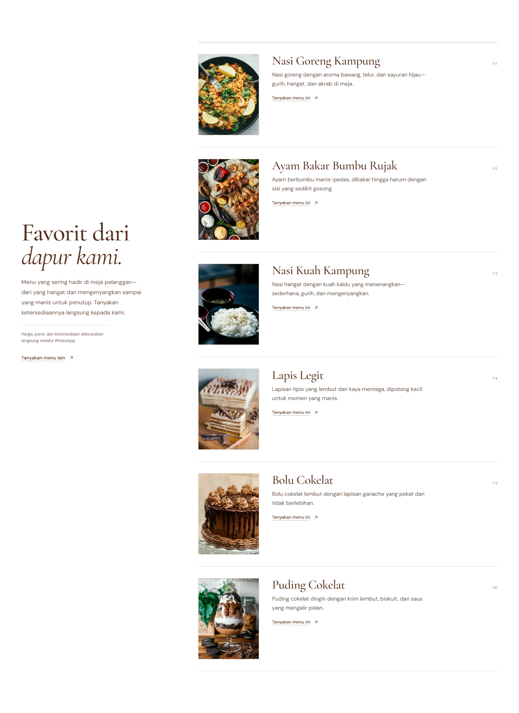 | 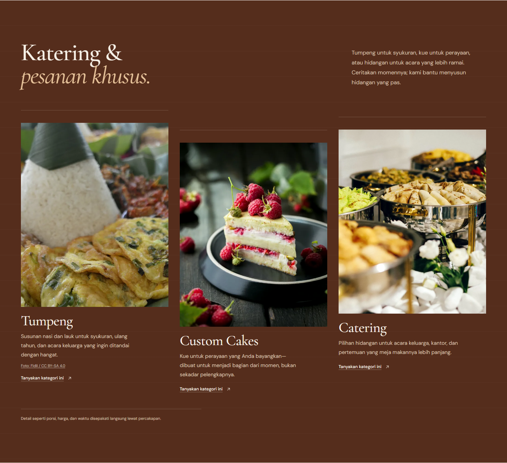 |

| Our Story | Why Choose Us |
| --- | --- |
| 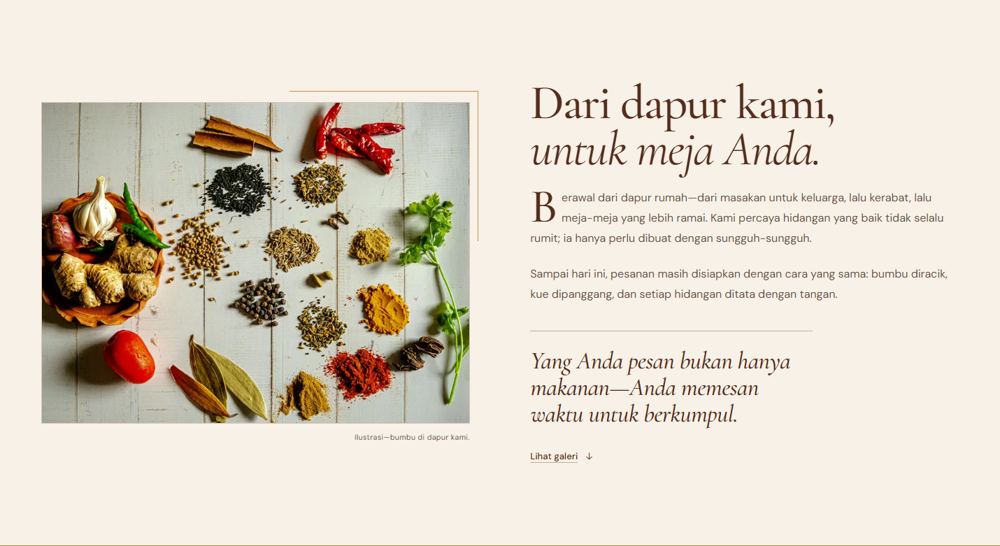 | 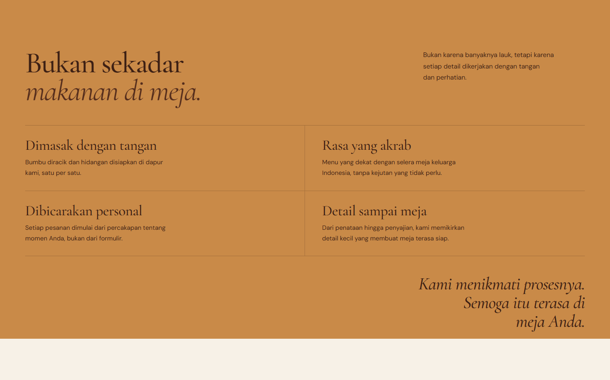 |

| Food Gallery | Recipe E-book |
| --- | --- |
| 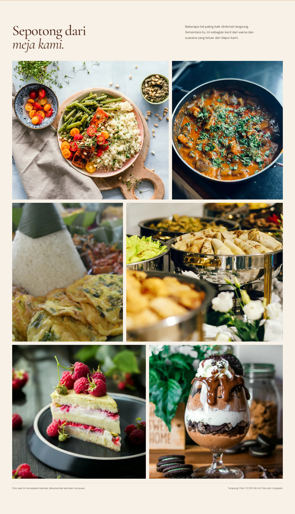 | 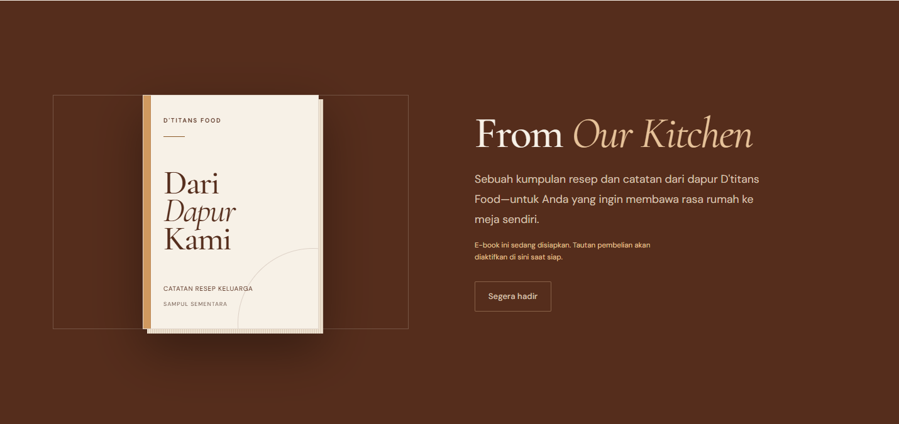 |

| How to Order | Available On |
| --- | --- |
| 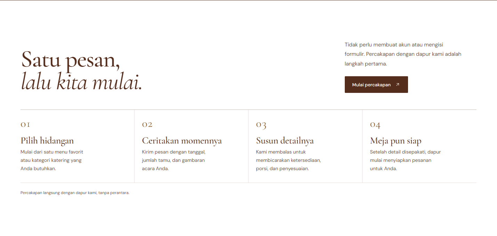 | 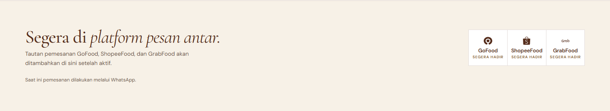 |

## Verification record

| Check | Result |
| --- | --- |
| `npm run build` | Passes; static output written to `dist/` |
| `npm run check` (Astro/TypeScript) | 0 errors, 0 warnings, 0 hints |
| Console/page errors | None during full page load and interaction capture |
| Horizontal overflow | None at 360, 390, 768, 1024, 1440 px (`documentElement.scrollWidth` inside each viewport) |
| Axe WCAG 2.2 AA scan — 1440 px | 0 violations |
| Axe WCAG 2.2 AA scan — 390 px | 0 violations |
| Axe scan with mobile dialog open | 0 violations |
| Internal anchor targets | All resolve; none dead |
| WhatsApp links | 16 generated links; product/category name encoded in the prefilled message |
| Placeholder food-app links | 0 anchors, 3 non-interactive `aria-disabled="true"` items |
| E-book placeholder CTA | Non-interactive `aria-disabled="true"` state |
| Mobile menu | Opens, traps focus, closes by Escape and navigation |
| Image loading | 22 images in capture; 20 lazy below fold; hero is eager with `fetchpriority="high"` |
| Sitemap / robots | Both emitted at build time |
| H1 accessible name | “Sajian Lezat untuk Setiap Momen.” |

Automated checks are not a substitute for a manual review with a real screen reader or with the final photographs in place.

### Finish review

The shipped finish-review agent was launched but did not return a verdict (it stalled without output). The final pass was therefore completed directly against the direction contract, the craft floor, and the captures above; that substitution is recorded here rather than presenting it as an independent external review.

Disposition at implementation scope: **ship**. The direction contract's first viewport, ledger system, typography, material/ground, reduced-motion behavior, and placeholder honesty are all present in the build. The only open items are the client-supplied content and asset substitutions in **Known limitations**, not unresolved visual or code defects. `DESIGN.md` and `.impeccable/design.json` were generated inline from the shipped implementation.

## Acceptance criteria

| Requirement | Status | Notes |
| --- | --- | --- |
| All sections in required order | Met | Verify visually in the full-page screenshot |
| Responsive at 360/390/768/1024/1440 | Met | No overflow at all five widths |
| Functional anchor navigation | Met | Desktop, mobile menu, hero quick links, footer |
| WhatsApp message generation | Met | Message includes selected product/category; number is a placeholder |
| Food-app placeholders do not jump | Met | Rendered as disabled, non-anchor items while URL is `#` |
| Content editable through source data | Met | `src/data/*`; core headings and all section copy centralized |
| No CMS or backend dependency | Met | Static Astro output only |
| Production build passes | Met | `npm run build` |
| No fabricated reviews/ratings/awards/certifications | Met | None present |
| No invented prices/variants/packages/lead times | Met | None present; details are explicitly deferred to WhatsApp |
| E-book purchase URL configurable | Met | URL unset by default; active link only when a valid URL is set |
| Available-on links configured `#` | Met | All three; navigation prevented |
| No claim of live platform integration | Met | Copy says “Segera”; each item is disabled |
| Report with screenshots/known limitations | Met | This document |

## Architecture

```text
src/
  components/     Header, Hero, Favorites, Catering, OurStory,
                  WhyChooseUs, Gallery, Ebook, HowToOrder,
                  AvailableOn, Footer, Logo, Icon, WhatsAppLink
  data/           site.ts, content.ts, products.ts, services.ts, gallery.ts
  layouts/        BaseLayout.astro
  pages/          index.astro, robots.txt.ts
  styles/         global.css
  assets/images/  brand, hero, products, catering, story, gallery
public/           fonts, platform marks, favicon, OG image
```

The build is intentionally static and asset-local. Images use Astro’s image pipeline; no runtime fetch of images or fonts is required.

## Known limitations

These are content/asset gaps, not unfinished UI.

1. **Photography is placeholder stock, not D’titans Food.** AI image generation was attempted but the configured OpenAI key returned `429 insufficient_quota`, so no generated imagery exists. Licensed stock illustrations were used instead and are labelled as illustrations in the hero caption, gallery footnote, and footer. Replace them with real product and kitchen photography; [IMAGE-GUIDE.md](IMAGE-GUIDE.md) contains prompts, aspect ratios, and step-by-step replacement notes.
2. **Contact details are placeholders.** `whatsappNumber` (`6281234567890`) and `instagramUrl` in `src/data/site.ts` are demo values. The WhatsApp links technically work, but the number is not monitored. Replace before launch.
3. **Platform logos are temporary stand-ins.** No official GoFood, ShopeeFood, or GrabFood assets were supplied. The Available On row currently uses parent-brand marks from Simple Icons (Gojek, Shopee, Grab) in a monochrome treatment. Replace with official assets from each platform’s merchant/brand portal.
4. **All food-app URLs are unset (`#`).** The UI renders disabled “Segera hadir” items and does not claim an integration. Setting valid `https://` URLs in `foodApps` will turn them into working links automatically.
5. **The e-book is not available.** The CSS cover is explicitly marked “Sampul sementara.” The purchase URL is empty and the CTA is disabled. Set `ebookPurchaseUrl` when the e-book is live.
6. **Some copy is draft.** Menu names, item descriptions, and the “Our Story” narrative were authored for this build because the client supplied none. Confirm the actual menu, origin story, and claims with the owner. The copy avoids specific years, prices, capacities, reviews, and certifications.
7. **Production domain is placeholder.** `https://dtitansfood.com` is configured for canonical/SEO/sitemap purposes only. Change it in `astro.config.mjs` and `src/data/site.ts` once the live domain is known.
8. **Tumpeng photograph attribution.** The tumpeng crop is adapted from Fidii’s “Sega Tumpeng,” CC BY-SA 4.0, via Wikimedia Commons. The gallery credit line must remain while that photo is used. See `CREDITS.md`.
9. **No backend functions by design.** There are no forms, order persistence, stock checks, scheduling, payments, analytics, or CMS. Inquiries remain a WhatsApp conversation.
10. **Automated accessibility is a floor.** Axe produced zero violations, but a manual screen-reader pass and final content review are still recommended after replacing the copy and assets.

## Recommended launch sequence

1. Supply and integrate the final WhatsApp number, Instagram URL, and domain.
2. Replace stock photography with approved D’titans Food photos; keep or improve alt text and update credits.
3. Replace temporary platform marks with official brand assets.
4. Confirm the real menu, category descriptions, story copy, and any commercial details retained off-site.
5. Add the e-book purchase URL and platform store URLs when they exist.
6. Run a final manual accessibility and mobile-device pass, then deploy `dist/`.
